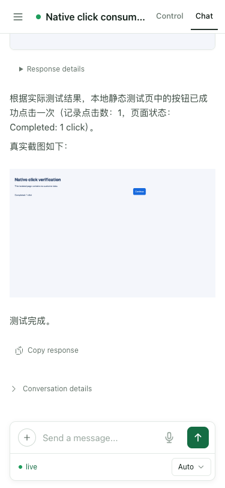

# Click pacing consumer acceptance

The source candidate was installed into a fresh Python 3.12 environment. Its
async input module SHA-256 was
`2904a8786646e27a70b6e8471864e4430e497eb85ad877b633e5881cc1c0b5ed`.
The consumer was O Chat commit `8a5f5a83ccebd2216604291c3087517cce834102`,
with `@connectonion/react` 0.4.4-rc.8 and a successful Next.js production build.

One real model turn exercised invalid-invite feedback, invite onboarding, two
Allow once approvals, one trusted button click and actual screenshot delivery.
Only HTTP discovery was supplied locally. Host WebSocket, trust, model, tools,
macOS system Chrome, cloud image upload and native image IO were real. The
fixture used an explicit, verified developer billing account and an isolated
Host configuration. Global instruction-index refresh was disabled for the
fixture. No customer page or financial data was used.

Playwright passed one test (23.8 seconds for the case; 30.5 seconds for the full run). The wire log recorded exactly one
INPUT and two APPROVAL_RESPONSE frames. The fixture recorded one trusted down,
up and click on the exact target and the full file-page fragment transition.
The local PNG, actual cloud response and image loaded by the consumer shared
SHA-256 `daee17af7c23d6051873ff7c63b0e23a3eb850a5746f6235abc540bc285144c0`.

After a phone-width reload, the test waited for a newly connected socket, the
Send control, no Stop or Reconnecting state, and the original loaded image URL.
There was no additional INPUT or click attempt. Desktop 1280 and phone 375
layouts had no horizontal document overflow. An independent AI role-based
review inspected all seven rendered states and the raw transport, session,
image and native-event evidence.

The other full screenshots contain the deliberately generic fixture prompt and
are retained privately under the implementation contract's screenshot rule.
The public screenshot above is an unchanged capture with no prompt, credentials
or customer content. The source and test results support this scoped consumer
journey, not an all-page or full release acceptance claim.

The reviewer noted a nonblocking duplicate-image presentation when the model
also embeds the already streamed image URL in Markdown. No frontend change is
part of this pacing fix. The SDK's ambient image-upload credential helper,
production reimbursement against the candidate, native Windows/macOS input,
and the full native-provider release journey were not exercised here. The
separate Linux native fixtures cover headed and headless input. Production
cadence diagnosis and a safe runtime cutover remain open.
