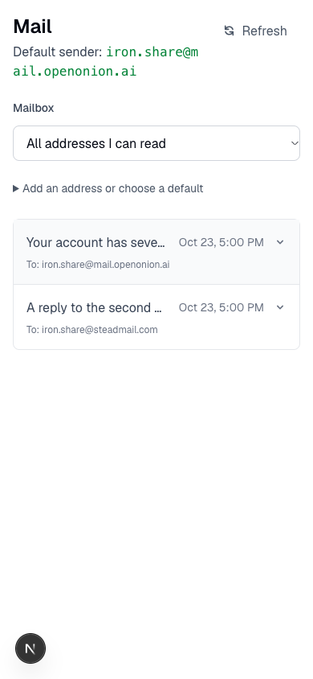
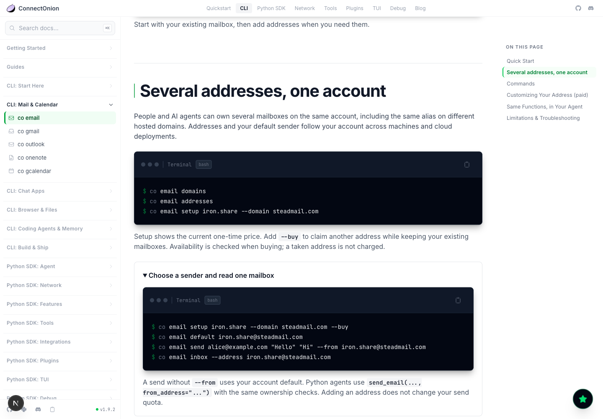

# Hosted mailbox domain audit — 2026-10-23

## Before

The production `/api/v1/email/addresses` exposed mail.openonion.ai,
steadmail.com, trustxmail.com and oakinbox.com. Resend only had
mail.openonion.ai verified. The three branded domains had not been registered
with Resend. steadmail.com and oakinbox.com lacked inbound MX records.
trustxmail.com had Cloudflare MX records; its catch-all could not be inspected.

## Work performed

Registered the three branded domains with Resend in ap-northeast-1. Added each
domain's Resend DKIM TXT, SPF TXT, return-path MX and tracking CNAME in its
Cloudflare zone. Requested verification. The provisioning command lives in
oo-api `scripts/configure_email_domains.py`, defaults to read-only inspection,
and refuses conflicting DNS or an existing active catch-all to another target.

## Outstanding acceptance

All three branded domains are now verified by Resend. Cloudflare's production
token could manage DNS but Email Routing API requests returned HTTP 403. The
Cloudflare browser session required login. The owner was asked to provide
Email Routing Rules/Settings permissions or sign in before enabling inbound
routing. No claim is made that the branded domains can receive email yet.

No mailbox was bought and no message was sent to establish live end-to-end
acceptance. Package regression tests do not establish DNS or mail delivery.

## Independent experience review

A separate AI reviewer used a technology-founder, marketing and UI perspective.
This is a role review; no human founder participation is claimed.

| Priority | Evidence and user impact | Fix and recheck |
| --- | --- | --- |
| P1 | `is_default` was written but not read by implicit sends; mail could leave with the wrong sender. | Read the owned default before legacy tier settings. Regression follows the real sender selection into the provider payload. |
| P1 | Two branded domains had no incoming MX; the API nevertheless offered all three for purchase. | Add deployment domain allowlisting; only enable branded domains after routing/delivery acceptance. Verify production `/email/addresses` after deploying. |
| P2 | Mail showed only the derived address and did not distinguish destination mailboxes. | Show actual default, owned-mailbox filter and every message's To. Review filter and message expansion on desktop and mobile. |
| P2 | Old rendered docs advertised a Plus custom domain and implied a new name always overrides the default. | Correct hosted-domain examples and preserve-selected-default semantics in rendered and raw Markdown docs. |
| P2 | Mail's help summary lost its native disclosure marker. | Restore the marker; recheck the actual mobile render. |

Actually inspected `/cli/email` at 1440×1000 and 390×844, with its new details
collapsed and expanded. Inspected the real MailTab component through a temporary
local fixture: normal, empty, mail-loading error and address-loading error at
390px and 1440px; mailbox filtering, body expansion and help expansion. No
whole-page horizontal overflow was observed. The fixture was removed before
commit and is not shipped. This does not cover authenticated production states,
real mailbox purchases, Cloudflare routing or live mail delivery.

## Follow-up verification for 1.9.3rc19

The fresh SDK/CLI email suite passed 114 tests. Backend regression passed 907
with 200 skipped; eleven ownership contracts ran against real local PostgreSQL.
The additional contract checks a unified inbox across different names and all
four hosted domains; selecting a default sender does not split received mail.
New setup checks cover signed-out access, settings authorization failure, and
backend-disabled reserved domains without attempting a purchase.

A fresh production inspection still found all three branded sender domains
verified in Resend and Cloudflare Email Routing API requests rejected with 403.
This round does not establish branded-domain incoming delivery. The live owner
account was read only; no mailbox purchase or message send was used as a test.

An independent AI role reviewer approved the new CLI and PostgreSQL contracts
and rechecked the actual public `/cli/email`, `/releases`, and domain Design
Journal pages on desktop and mobile before publication. No new blocking issue
was found. The current public preview was rc18 at that inspection; rc19 labels
and installation instructions require a post-publication recheck. Screenshot
capture failed in this round; page reads and layout checks succeeded. This
coverage does not establish every page or live delivery acceptance.
