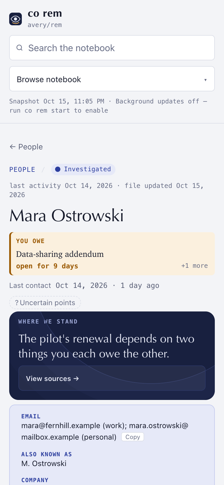
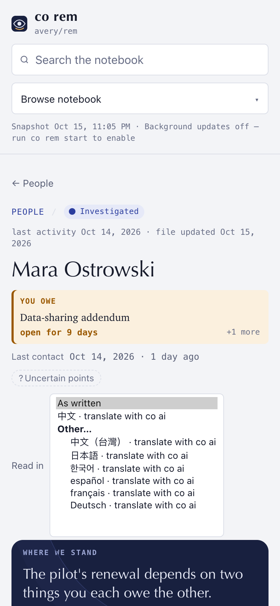
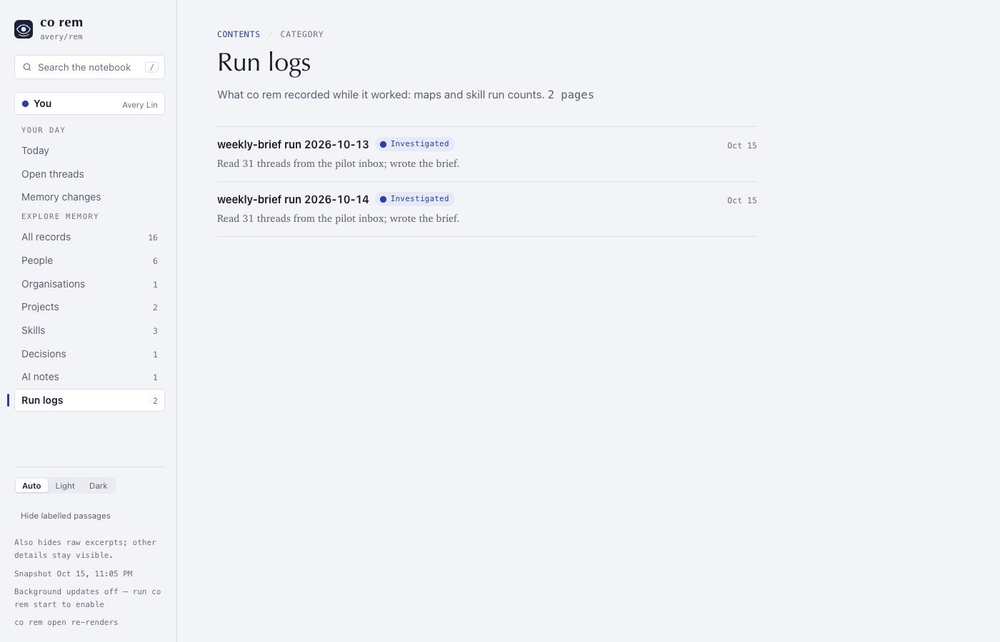
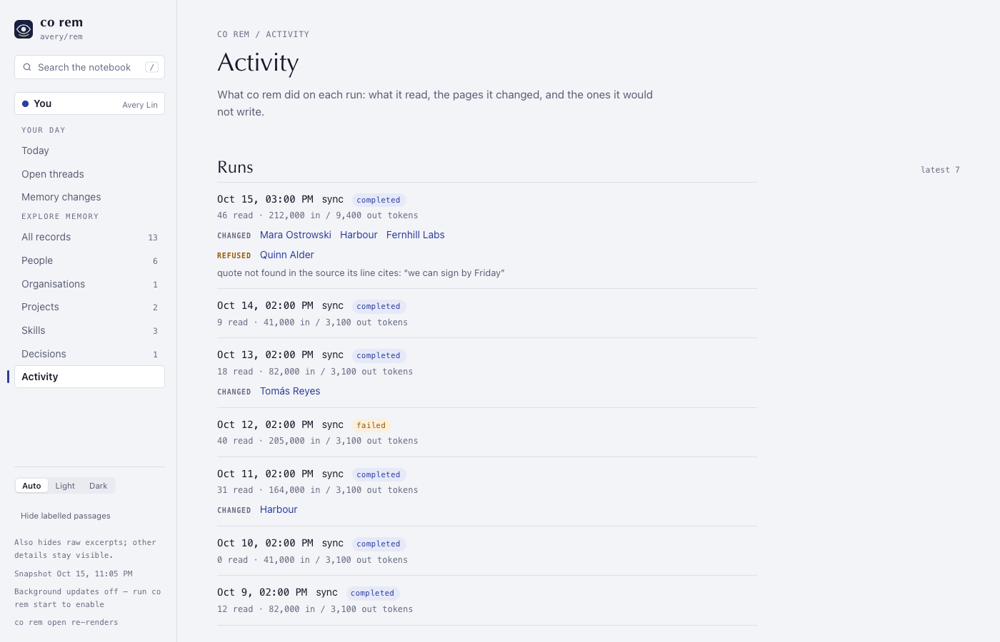

# ConnectOnion 1.9.3b5 (beta)

## Install this preview

Stable remains 1.9.2. Install this opt-in beta by exact pin:

```bash
python -m pip install --upgrade 'connectonion==1.9.3b5'
```

## REM pages you can trust on the first run

This preview is about `co rem`'s first run on a real notebook. The 1.9.2b3
notebook (2026-10-10 to 10-15, 180 days of mail and sessions) and two later
trials were audited claim by claim. The problems were wrong facts that looked
right, and good pages lost because of one small fault. Both are fixed here.

### What a page says is checked against where it came from

- **Quotes are checked word for word.** Pages now quote the words people may
  act on (an ask, a term, a decision) instead of paraphrasing them. Every
  `“…”` on a person, organisation or project page must appear in a source its
  line cites. On the 1.9.2b3 notebook 8 of 89 quotes were not in their source:
  a fee quoted as gross where the owner had written net, and Chinese turned
  into English.
- **Every page about people and work is audited.** The cited-claim audit used
  to run only on project investigations. It now runs on every write of a
  person, organisation or project page, reads the material that turn read, and
  names each claim it could not find.
- **Contact facts are the person's own, or `Unknown`** (#2348). A phone number
  stays only when a mail the person sent shows them giving it. Before, one page
  carried a facilities manager's mobile from an estate notice the person had
  forwarded, and another carried someone else's mobile from an event host's
  message.
  A relay address (Luma, `lu.ma`, Airbnb's message relay) is never anyone's
  email. Company comes only from the newest domain someone writes from, never a
  mailbox provider, relay, agent or student address. Last contact is the last
  human mail, not a notice or a mail to more than five people.
- **Sources are dated by the runner.** Each source is listed once and dated
  from its original. The audit had found one mail cited as [1] and [2] with two
  different dates. Every page writer and the audit are now told today's date:
  one page kept the 13th's and 14th's events as open threads on the 15th.
- **Only what you typed is cited as you.** Session prompts a program sent (a
  scheduled job's prompt, REM's own model-access check) are no longer quoted as
  your words, and old citations of them are tidied once.
- **Your own company gets no organisation page.** Domains that are yours, or
  named like your Company, are not queued as a counterparty.

### Good pages are repaired, not refused

- **Two repair turns before a refusal.** Every page type now gets two repair
  turns that name what review refused. What is still refuted after that is
  removed with its sentence (a contact field says `Unknown`), and the rest of
  the page is saved. `review.json` says how many claims went. On a 1.9.3 trial
  run, one unmatched claim had cost 10 of 28 pages and 29M input tokens; a
  refuted claim that no line holds now refuses nothing.
- **Code settles what code can.** Glued or repeated sections are merged, a
  citation to mail REM already holds is resolved from the archive, inline
  source ids are numbered before Facts are checked, and a leftover "not
  investigated yet" is removed. Before, one person's page was refused for two
  real mails the turn had not been handed, and seven true Facts fields were
  lost on another.
- **Maintenance sees the rest of the thread.** Upkeep and the audit get the
  later messages in a batch's threads, so a question answered the next day is
  not left open.
- **One refusal ledger, retried with a cap.** Every path that can refuse a page
  writes `.state/refused-investigations.json`. Before, one of eight refused
  pages reached it. Later runs retry ledger pages once every 20 hours; a page
  refused three times on the same material waits for new material. Naming a
  page (`co rem investigate "Name"`) retries its refused material.
- **No shrinking rewrites.** A maintenance turn that keeps less than 60% of a
  page's size or cited sources keeps the old page. One project page had been
  cut from 14,356 to 4,132 characters.
- **Fewer wasted turns.** Each sync starts at the source after the one it read
  last (in 26 syncs Claude Code, Gmail and Outlook were never read). Project
  pages with folders are routed by folder only and written by the project
  writer at most once in 20 hours unless 10 messages wait (one page had 12
  turns in 26 syncs, 9 of them NO CHANGE, 5.36M tokens).

### Read a page in your own language

- **`co rem config set language zh`** writes new pages in your language.
  Headings, Facts labels, source ids and quotes stay as they are.
- **Your languages are detected** from your own sent mail and typed session
  messages, one vote per message. The owner's notebook came out 59% Chinese
  and 41% English. `co rem config set languages zh,en` overrides it.
- **`co rem open` starts the live reader** on this computer through co ai and
  opens it at `127.0.0.1`. Under a page's title, **Read in** offers your
  languages first, then the person's own, then the rest. A translation is one
  co ai turn, cached until the page changes. `co rem translate "Name" --to zh`
  does the same from the terminal. `co rem open --local` is the offline
  snapshot, and it falls back to it, saying why, when co ai cannot start.




### Activity instead of Run logs and AI notes

The reader's sidebar listed "AI notes" and "Run logs" as memory categories;
Run logs were skill reports and maps, while the real run history sat at the
bottom of Today. Both are now one **Activity** view: each run's time, kind,
outcome, items read, tokens, the pages it changed and the pages it refused,
with the reason.




### The terminal

- `co rem status` leads with the open threads **waiting on you**, counted the
  way the reader counts them, and "To write next" counts only pages its
  command would write.
- One census: `investigate` and `status` no longer disagree on how many pages
  are written.
- `co rem list people --table` shows names instead of Markdown links, fits the
  terminal, and never shows a relay as an email.
- "Organisations" everywhere, as the reader spells it.

## Also in this preview

- **Claude Code projects found after session preambles** (#2347, fixes #2336, thanks to Jasper,
  [@jipeng6036-del](https://github.com/jipeng6036-del)): Claude Code can begin a
  session with queue or mode records that carry no working directory. Project
  discovery stopped at the first record and missed the project; it now reads
  ahead to the first working directory, bounded to 256 records or 1 MB.
- A cited project file that is not UTF-8 (cp1252, for example) is read instead
  of crashing the investigation.
- An unexpected investigation failure keeps its traceback in the run record,
  for `co rem logs`.
- The scheduled job imports the checkout it runs, never the shell's
  `PYTHONPATH`.
- The handoff prompt pins 1.9.3b5. Handoffs already sent keep their version.

## Verification and limits

- Unit tests for REM, handoff, release and CLI discovery, and the REM CLI
  end-to-end tests, pass on this branch.
- Screenshots use the invented notebook from the reader's tests, rendered by
  1.9.3b4 and by this release in headless Chrome.
- Removal is only as good as the audit: a wrong claim the audit does not flag
  stays. A quote whose source is not held is left to the audit.
- Some true contact facts now read `Unknown`, such as a number given only in a
  quoted reply. Add one with `co rem stub`.
- Translation needs co ai and a working runner (Codex or Claude Code). Only the
  live reader can make a new one; the snapshot and O Chat show cached ones.
