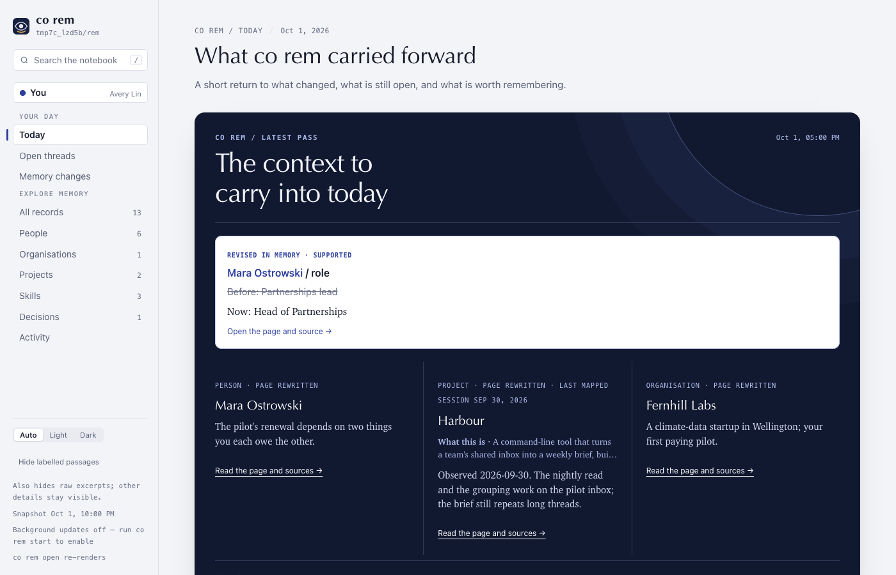
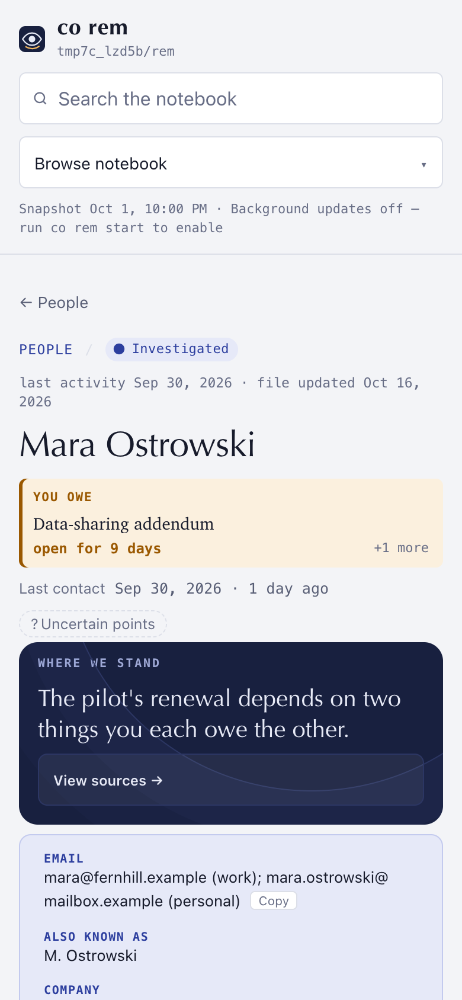

# ConnectOnion 1.9.3rc1 (release candidate)

## Install this preview

Stable remains 1.9.2. Install this release candidate by exact pin:

```bash
python -m pip install --upgrade 'connectonion==1.9.3rc1'
```

## REM you can show

1.9.3b5 made `co rem` pages checkable. This candidate makes them readable,
and it was given the run a user gets: a fresh notebook, `co rem init` over 180
days of the owner's mail and coding sessions, Codex as the runner, sixteen
workers, overnight. Pages were sampled and audited claim by claim against
their sources.

### What the first run found, and what it shows now

- **Finished pages were lost after their paid turns.** On the code as it stood
  at the start of the night, 26 of 63 person, organisation and project runs
  failed with "co rem is busy" after their model turns had run. The claim
  audit asked for the notebook lock without waiting, while init's background
  backfill takes that lock for each saved mail. About half of the night's
  input tokens up to that point went to pages nothing kept; the longest lost
  page alone had spent 5.9M. A finished page now waits for the lock before its
  audit, and names the kept candidate if it times out.
- **On the fixed code, 66 pages were accepted, none refused, and none failed
  after a paid turn** (44 people, 16 projects, 6 organisations).
- **Misleading claims: 17% of 54 sampled** (people 8 of 32, organisations 1 of
  8, projects 0 of 14), against 45% of 77 on the 1.9.2b3 notebook.
- **Wrong phone numbers: none** of the five non-owner numbers on the pages,
  against two before. A page that had carried someone else's number now says
  `Unknown`.
- **Quotes: 314 checked, none invented.** Two were flagged: one has a link
  between the quoted words, the other cites the neighbouring session line.
- **No relay address and none of the owner's addresses** on anyone else's page.

### Person pages

- **A three-sentence lead:** who they are, what is live, the next step.
- **Open threads say who owes whom** as "The user owes X:" or "X owes the
  user:", and only between the user and that person. A request between two
  other people, or an ask nobody accepted, is no longer the user's debt.
- **Threads are read whole**, most recently active last, so a question
  answered in a later reply is not left open. History is one line per thread
  with how it ended.
- **An editing round cannot gut a page.** It removes hedge clauses, never the
  lead; a round that cuts a third of the page, or paraphrases away the owner's
  quotes, is undone. A page the audit left without a lead keeps its previous
  version.
- **GitHub lookups are sources.** A turn asks for `github:<repo>#<n>` or a
  repository search the way it asks for mail, by repository and date rather
  than a login the mail never names, and what it finds can be cited. The
  issues a page cites are kept, so the reader and the audit can open them.

### Project pages

- **Read from the current line of the repository**, with its history, not from
  a stale checkout. The page opens with what it is, why, where and what is
  next, in the owner's decisions; its dates come from the history.
- **One packet per round, and rounds keep what earlier rounds established**
  instead of auditing it away. A final round with no new material may tighten
  a page, not gut it.
- **No History heading on a project page.** Paths are its folders, not its
  modules; a squash-merged branch is not work in flight; every arrow in a
  diagram is a step its source states, and a refuted arrow drops the diagram
  instead of the page.

### The reader

- **The home opens on what is waiting on you**, newest and due first. The
  rail, Open threads and `co rem status` share one count of threads waiting on
  you. Last night's band shows only real overnight changes; threads quiet for
  60 days fold into **Gone quiet**.
- **A person page opens on Between you:** the lead, one contact line, what you
  owe them and what they owe you, where it stands, and five recent events. The
  full page and its sources sit in a closed disclosure. The longest person page
  of the first run went from 16,471px to 3,183px on a phone.
- **Citations name the sender, the source and the date** (sender, Outlook,
  22 Sep) instead of a number. A chip opens the original in a margin on a
  desktop and a bottom sheet on a phone, with the words the line quotes marked
  on both sides. A chip whose original is not held is dashed, the same size.
- **Night and margin, one visual system.** One dark surface (last night),
  amber for what waits on you, indigo for what changed, a yellow mark joining a
  line to its source. No raw source id on the first screen.






### First-run reliability

- No NUL character reaches a model turn's argv (an organisation page had lost
  two paid rounds to "embedded null byte").
- A mapped stub's first round may replace its only source, the map's
  enumeration, instead of being refused for "kept 0 of 1 cited sources".
- The audit no longer erases the email addresses the map found; Email, Handles
  and Also known as are checked by the contact rules, not the claim audit.
- An organisation's Last contact is computed from human mail at its domains
  (four of six sampled organisations had said `Unknown` beside dated mail).
- A mail merge the owner sent (one subject to five or more single recipients in
  three days) is nobody's Last contact.
- Mail a lead search reads is kept in the archive, so its citation opens.
- A later round cannot blank a dated, cited First or Last contact.
- Dates shown to the model are in the notebook's own time zone, so prose agrees
  with its Sources.
- Repeated citation markers (`[15][16][15][16]`) collapse when a page is saved.
- A Facts value that starts with `Unknown` is exactly `Unknown`.
- A `codex exec` session is a program's prompt, not the user's words.

## Also in this candidate

- **The maintenance lock works on Windows** (#2373 by
  [@Hugo-DDT](https://github.com/Hugo-DDT), fixes #2346), and the lock test now
  runs on Windows CI.
- **`co rem status` with an unknown quota meter** says pages still run,
  bounded by the daily call cap, instead of printing a raw `RuntimeError`
  (#2445; thanks to #2485 by @Hugo-DDT for the first version).
- **`co rem init` asks before scanning coding-session folders** (#2443; thanks
  to #2519 by @Hugo-DDT for the scan guard and the map line).
- The reader no longer shows a run whose process died as running (#2235).
- "Copy the file path" copies the absolute path, and the footer names the
  notebook root to re-render (#2146).
- CI's remote-browser-egress job is bounded at 20 minutes (#2345).
- The handoff prompt pins 1.9.3rc1. Handoffs already sent keep their version.

## Verification and limits

- Evidence: the first run above, on a fresh notebook from the owner's real
  accounts (2026-10-16). Its pages are private; the numbers are from the claim
  audit of sampled pages, the quote checker over every investigated page, and
  the run records.
- Unit tests for REM, handoff, release and CLI discovery, and the REM CLI
  end-to-end tests, pass on this branch. Each first-run fix has a regression
  test.
- Screenshots use the invented notebook from the reader's tests, rendered by
  1.9.3b5 and by this release in headless Chrome.

Known and open:

- **Model inferences still slip through.** Most of the misleading claims left
  are an inference beyond the source, or a quote attached to the wrong act:
  code checks a quote's words, not what it is said to prove.
- **Some resolved threads are still shown open**, such as an acknowledged
  commitment, or GitHub work that exists but was not looked up.
- **Duplicate pages:** the same person or company can have two pages; there is
  no merge yet.
- **Signing entity** may show the owner's own company or a team name.
- **`co rem init` does not ask for the owner's addresses before investigating.**
  Add them with `co rem init --mine`.
- **The time estimate is far off.** Under load a person page took about 11
  minutes (median), and the estimate for a full first run was several times
  too short.
