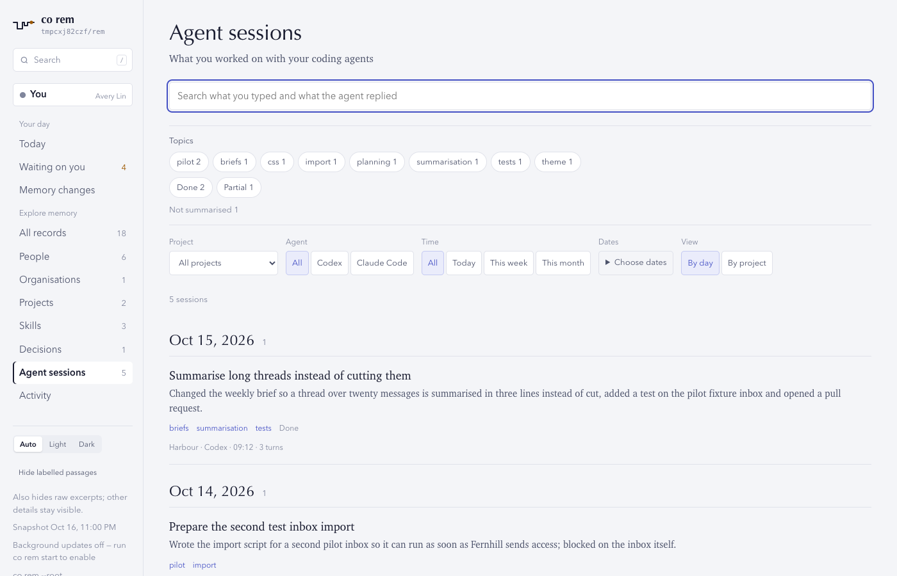
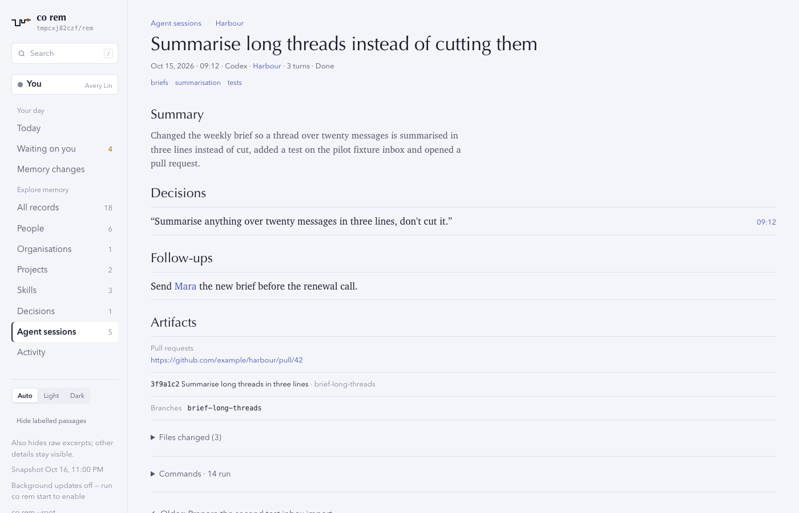
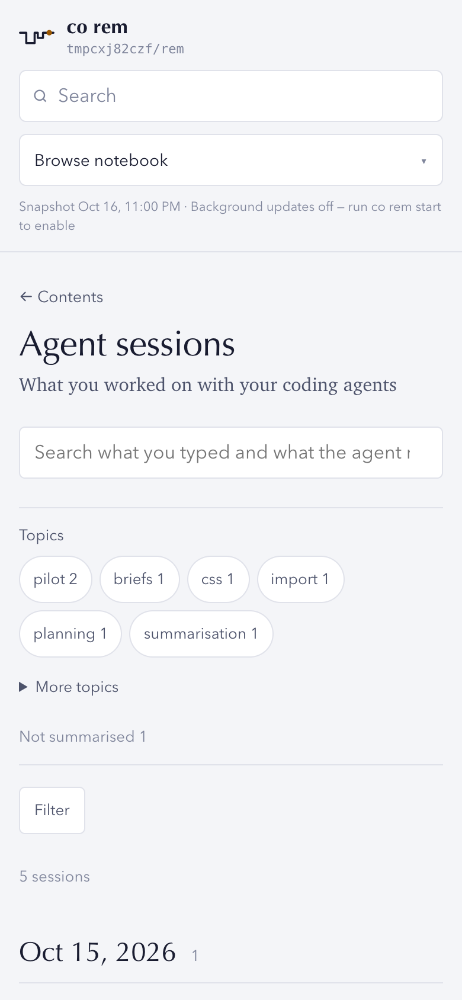
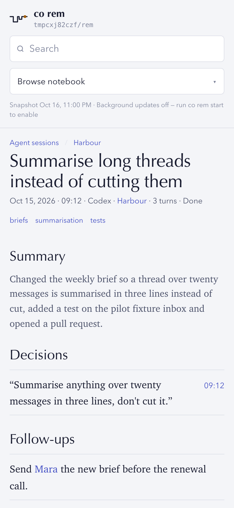
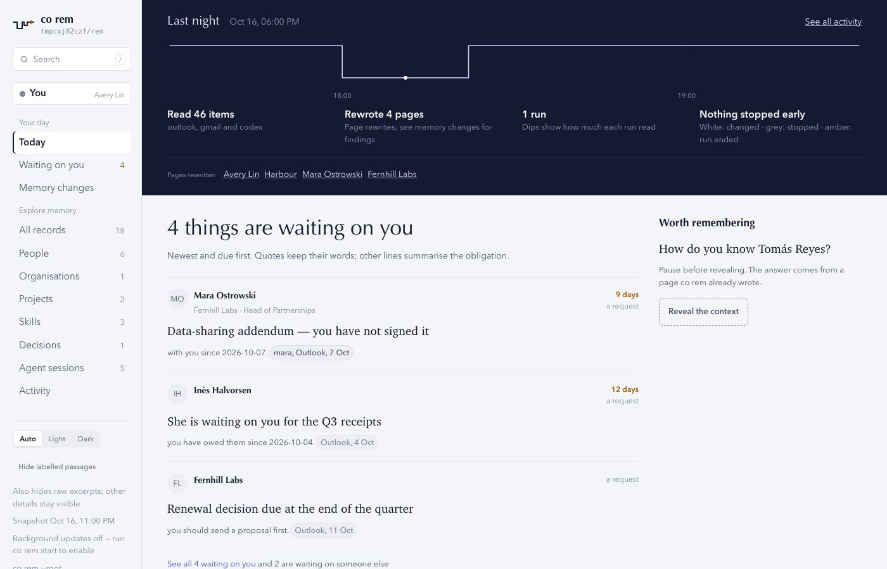
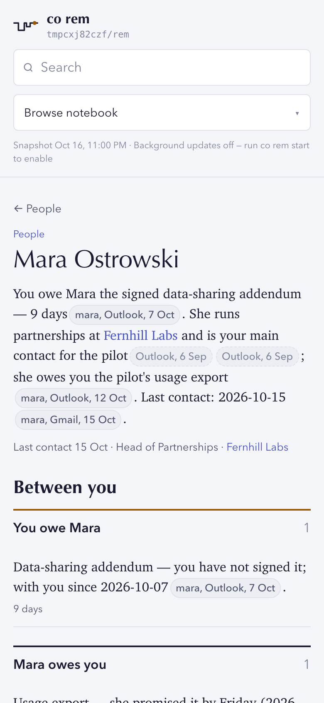

# ConnectOnion 1.9.3rc2 (release candidate)

## Install this preview

Stable remains 1.9.2. Install this release candidate by exact pin:

```bash
python -m pip install --upgrade 'connectonion==1.9.3rc2'
```

## Agent sessions

`co rem` already read your Codex and Claude Code sessions to write people and
project pages. It now keeps the sessions themselves: one page per coding-agent
conversation you typed in, under `sessions/`, and an **Agent sessions** list in
the reader.

```bash
co rem import sessions                 # one page per session, no model
co rem import sessions --summarise     # add a title, summary, tags and outcome
```

- **One page per conversation, no model.** Each page holds the messages you
  typed, in order, the agent's final reply, and a link to the project whose
  folder the session ran in. Secret-shaped text is removed. Init and sync run
  the import; a re-run rewrites a changed session in place and skips unchanged
  files.
- **What the session produced, read from its own tool calls.** Pull requests,
  commits, branches, changed files and the commands that change something
  outside the editor. A pull request counts only when the session's own
  `gh pr create` or merge printed it: one real page had listed 257 URLs from a
  `gh pr list`.
- **`--summarise` adds a title, a summary, three to six topic tags, an outcome,
  your decisions and open follow-ups**, eight sessions per model turn, up to 40
  (`--limit`). A decision is kept only when its quote is word for word in what
  you typed at that time; a follow-up that names a person or project links to
  its page. Init and the daily round summarise new sessions when the runner is
  ready. Each pass is its own run record with its usage.
- **Only your own sessions.** REM's own runs, `codex exec` and subagent
  threads, SDK prompts and sidechains stay out, as before. New in this
  release: probes run in a temporary directory (151 of 458 sessions on a real
  machine were "Reply with exactly: pong" and the like), and sessions whose
  first message is an instruction for an agent ("Read prompt.txt …", "You are
  an independent … auditor") are skipped. A Codex IDE preamble ("# Files
  mentioned by the user:", "## My request for Codex:") is not taken as the
  first line.
- **Sessions find their project.** A session started in a folder that holds
  many repositories (123 of 307 on a real machine) files under the project
  most of its tool calls touched. A session run in a worktree
  (`<repo>/.worktrees/<name>`, `.claude/worktrees/<name>`) files under the
  repository's project, even after the worktree is removed.

### In the reader

- **Agent sessions opens on its topics**: the tags the summaries gave and how
  sessions ended, each a filter, then one search over titles, summaries, tags,
  typed messages and final replies (every word must match; Chinese works
  without spaces). Filter by project, agent and time; group by day or by
  project. The search and filters live in the address, so a search can be
  bookmarked. On a phone the filters fold behind a Filter button.
- **A session page leads with its structure**: title, one facts line (date,
  agent, project, turns, outcome), tags, summary, your decisions with the time
  you said them, follow-ups, then what it produced. The conversation itself is
  below in a closed **Original conversation**, with an outline, find in
  conversation and long replies folded. Older and newer sessions of the same
  project are one click away.
- **A project page lists its ten latest sessions** with its top topics; a
  person page shows the sessions whose typed words name them; global search
  returns sessions as their own group.






## Reader fixes

- **One obligation is shown and counted once.** A promise recorded on four
  person pages, each citing the same mail and quoting the same words, was
  counted four times on home, Open threads and the census. It is now one row
  on the counterpart's page, listing the others as "Also on", and the counts
  agree.
- **Calm empty states.** With nothing open, home no longer says "See all 0
  waiting on you and 0 are waiting on someone else", and Open threads no
  longer lists three bands of "Nothing here."
- **Last night's runs are drawn as stretches.** Twenty runs inside half an
  hour had overlapped into a knot of dips and dots; nearby runs now form one
  segment with one dip and at most one changed and one stopped marker.
- **The source sheet shows the sentence a citation supports**, also for the
  second of two adjacent chips, which had shown the whole paragraph.
- **A project's hero leads with the newest Where it stands line**; the
  insight is the fallback for an empty or Unknown one.
- **An organisation titled by its domain shows its stated name**, with the
  domain as secondary text.
- **Code and paths keep their case**: a hero that starts with `origin/main` no
  longer reads "Origin/main". The This week list no longer shows a raw "Now:"
  before a project's line.
- **A private phone reads "(private)"** in the people table, instead of the
  number beside a cut-off label.
- **A project Overview without a flow becomes Unknown, not a refusal.** Two
  project pages had been refused whole because their Overview was a cited
  prose line instead of a fenced flow.




## Verification and limits

- The full unit suite, the REM help contract and the reader's browser design
  tests (desktop and phone) pass on this branch. Each fix has a regression
  test.
- Screenshots use the invented notebook from the reader's tests (owner Avery
  Lin) with five invented session pages added, rendered by this release in
  headless Chrome. No real person or session appears.

Known and open:

- **Summaries cost model turns.** `--summarise` is opt-in on the command line;
  init and the daily round summarise at most 40 sessions a pass.
- **The automated-prompt rule is narrow.** It recognises prompt-file handoffs
  and independent auditor or reviewer prompts; other harness prompts typed as
  a first message are still imported as sessions.
- Everything listed as open in the [1.9.3rc1 notes](1.9.3rc1.md) still
  applies.
