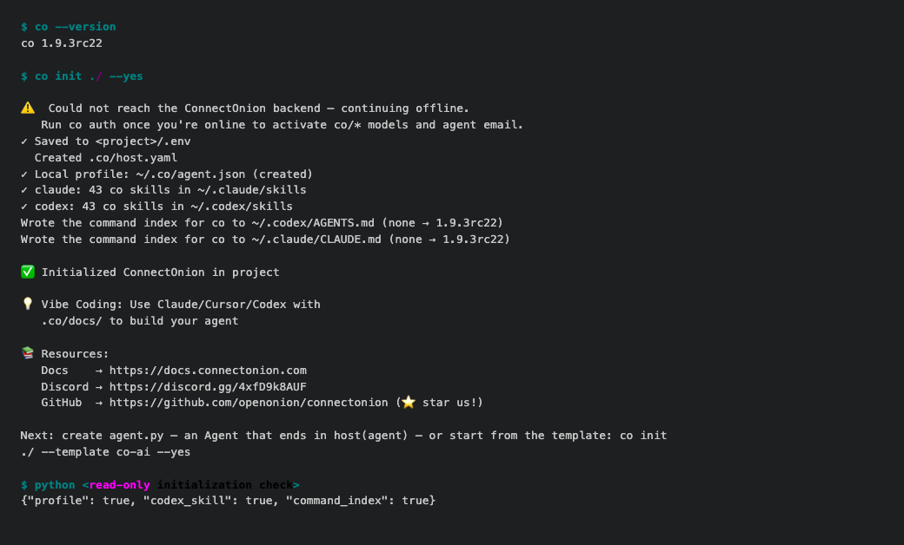

# ConnectOnion 1.9.3rc22 (release candidate)

REM initialization now opens **Codex Scheduled after native registration**,
including when the desktop is already running. A live App Server could coexist
with an inactive desktop scheduler. The revised order launches the app when
needed, confirms adoption, delivers Scheduled, then confirms activation.
Keep Codex desktop open and the computer awake.

Install the exact preview without enabling prerelease dependencies:

```bash
python -m pip install --upgrade 'connectonion==1.9.3rc22'
```

On the owner's normal Codex **26.924.22138** and managed App Server **0.164.0**,
scheduled work executed and auto-archived. A guarded desktop restart followed
by the revised initialization also executed without an extra manual UI step.
The real production REM scheduled pass completed; its native wrapper archived
and its old launchd job remained absent. This is local-file-mode acceptance.
The cold control requested 20:35 Sydney, indexed 20:36:33 and started 20:36:34:
**exact requested-minute timing is not established**.

Timer changes now wait for acknowledgement of their own requested definition.
Opening Scheduled can migrate a task or change its registration, so the old
clock is removed only after a second snapshot check. A native pause must be
confirmed before the worker is disabled or a replacement timer is started.
Status distinguishes saved intent, observed native state and completed REM work.

**Newer account-managed creation/update/pause/migration remain unverified.** The
adapter discovers known migrated IDs and refuses legacy file mutation; it does
not manufacture account ownership or silently create a second clock. Full
server/machine restart, sleep/wake, native desktop visuals and remote project
history were not accepted by these controls. Other runners, headless Macs and
different saved timezones retain the existing launchd route.

All four initialization entry points — `co init`, `co init ./`, `co create`
and `co setup` — now prepare the local profile, bundled skill links and coding
agent command index together. Rerunning repairs missing pieces while preserving
the signing key, custom profiles, healthy personal links, manual skill listings
and instruction text. Setup updates explicitly supplied profile fields; custom
global roots are used consistently by discovery, loaders and announcement
previews. Invalid bundled YAML description scalars are quoted.



Actual candidate-wheel output in a synthetic home with an offline backend.
The final read-only check reports all three integration files present;
[the same check on rc21](assets/v1.9.3rc22/init-before.png) reported them absent.
These are terminal transcripts, not native Codex UI captures.

The focused local onboarding checks and 16 installed-wheel CLI trials covered
fresh initialization, repair and preservation. Scheduling regressions cover
adoption, pause, account migration during Scheduled delivery, and concurrent
registration changes. The [acceptance record](https://github.com/openonion/connectonion/blob/v1.9.3rc22/docs/acceptance/1.9.3rc22/README.md)
separates those checks, normal-profile native receipts and remaining gaps.

This preview also inherits the reviewed mainline email PAYG-budget and
original-send status recovery changes from [PR #2676](https://github.com/openonion/connectonion/pull/2676).
Those were not a new live billing acceptance in this scheduling trial.

Stable remains **1.9.2**. Python **3.11+** is required; the cryptography 50.0.2,
Pillow 13.0.0, pypdf 6.21.2 and Paramiko 5.1.0 security floors are retained.
Publication is complete only when the matching PyPI version and GitHub
prerelease are public.
