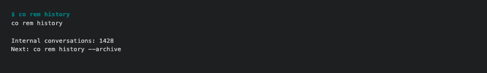
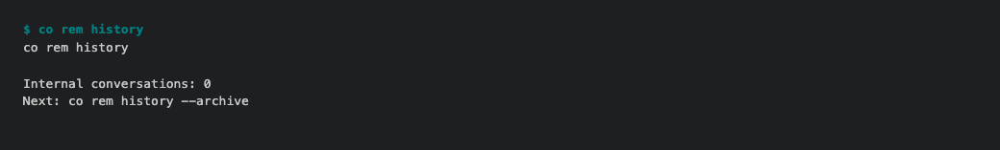

# ConnectOnion 1.9.3rc26 (release candidate)

REM's native timer could be working while old investigation conversations still
crowded Codex's active history. Recent calls already archived themselves; an
upgrade did not repair the earlier backlog. This preview adds that repair.

```bash
python -m pip install --upgrade 'connectonion==1.9.3rc26'
```

After source and schedule approval, `co rem start` archives eligible old internal
traces for that notebook. `co rem init` reaches the same startup. To inspect or
repair history separately:

```bash
co rem history
co rem history --archive
```

Eligibility requires a ConnectOnion originator or a recognized legacy REM
delegate prompt, the notebook's private task
directory, an unpinned record and an update older than one hour. Each operation
rechecks current metadata and native runtime state. Personal, pinned, active and
recent conversations are kept. An unarchived protected or unknown descendant
keeps its parent too, because native archive processes child conversations.
This does not mute automation failures or remove
ordinary work conversations. The repair makes no model calls, uses native
read/archive RPC, retains resumable history and records partial outcomes privately.
It does not edit Codex's databases or depend on a legacy JSONL file existing.

Normal-notebook CLI inventory: **1,428 eligible conversations before → 0 after
repair**. A final native active-list check also returned **0**, after recognizing
and archiving three additional legacy REM delegates. These counts cover internal
task conversations, not the account's ordinary work.





[Open the before transcript at full resolution](assets/v1.9.3rc26/history-before.png)
or [the after transcript](assets/v1.9.3rc26/history-after.png).

These are actual candidate CLI transcripts on the normal profile, rendered as
terminal images. They are not native Codex UI screenshots. The
[acceptance record](https://github.com/openonion/connectonion/blob/v1.9.3rc26/docs/acceptance/1.9.3rc26/README.md)
separates native metadata/API checks from visual coverage.

Local initialization also refreshes bundled skill symlinks into an older
installed package, fills missing profile fields while preserving edits, and
reports invalid metadata before later commands consume it. All four entry
points share this preparation. Their checks cover fresh and existing identities,
every bundled skill, the current command index and actual omission repair.
Personal skill directories and links outside installed package layouts remain
the user's overrides; missing personal source files are not recreated.

In the offline init trial, **all 44 bundled skill links were current after
repair**, missing profile fields were filled, and custom metadata survived.
[Before transcript](assets/v1.9.3rc26/init-before.png) ·
[After transcript](assets/v1.9.3rc26/init-after.png).

This fixes [#2696](https://github.com/openonion/connectonion/issues/2696).
Stable remains **1.9.2**. Python **3.11+** and existing dependency security floors
are retained. Native account-managed scheduling, exact-minute precision, broad
restart recovery and every remote/native UI state are outside this acceptance.
