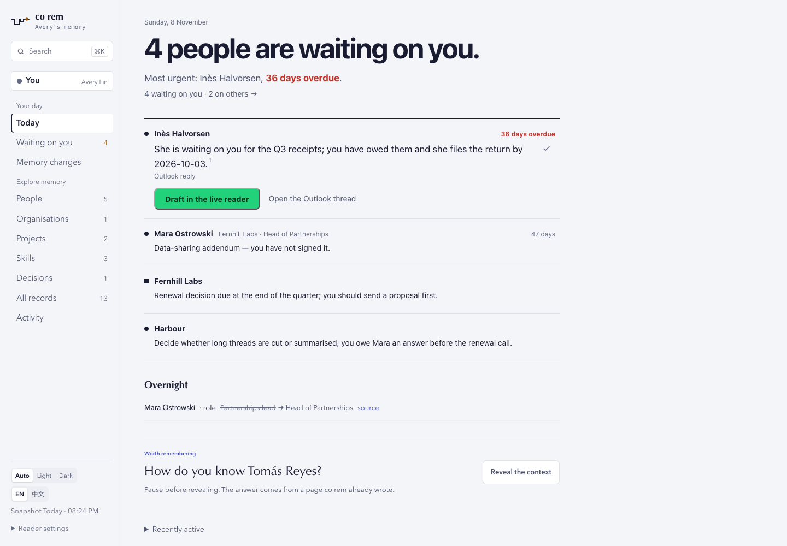
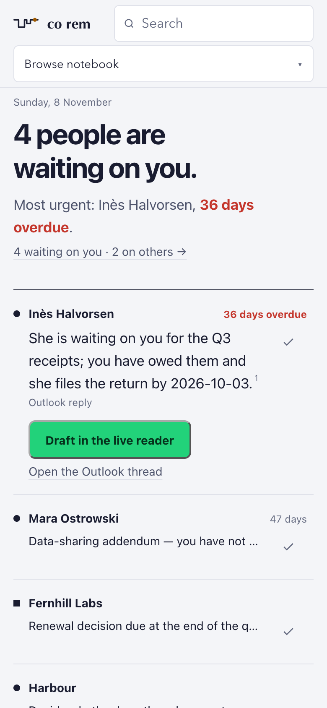
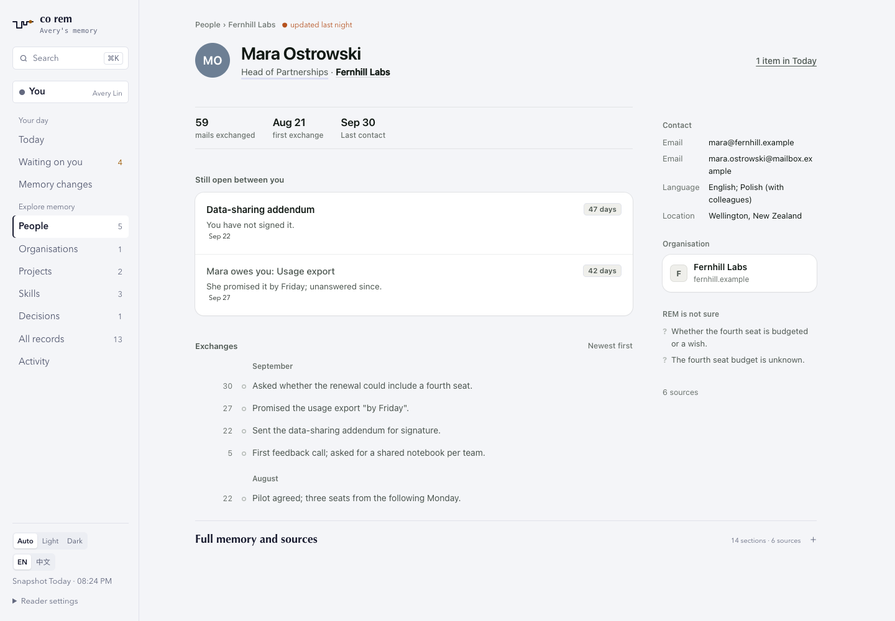
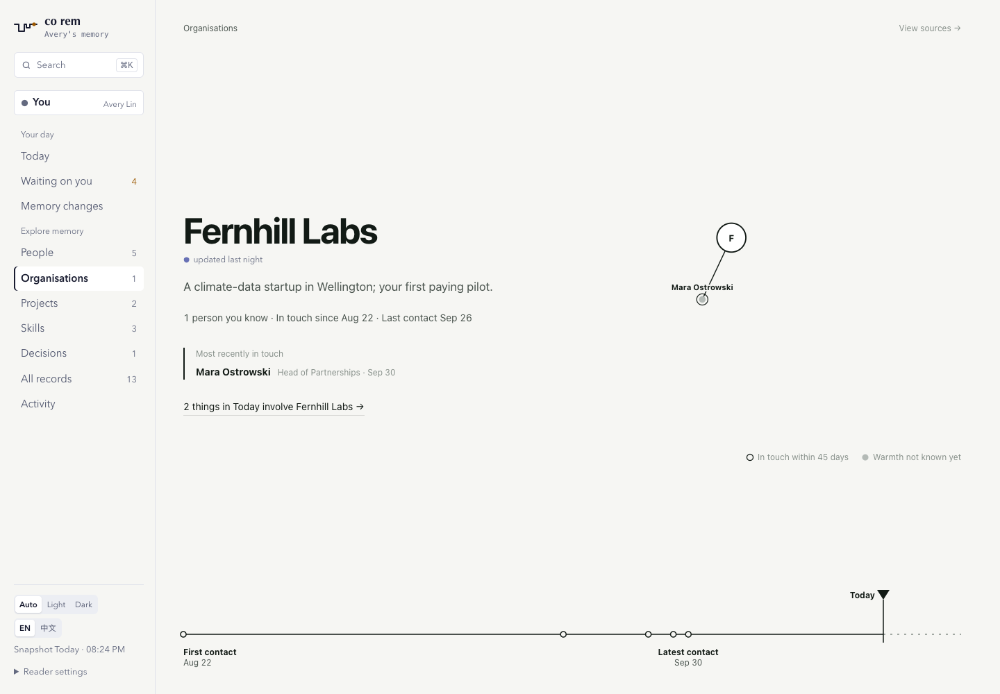

# ConnectOnion 1.9.3rc61 (release candidate)

Stable remains **1.9.2**; Python **3.11+** and the existing dependency floors are retained.

## Today: one statement, one card per person

- **One sentence first**: "4 people are waiting on you." at display size, then who is most overdue
  and by how much, then one link to everything waiting.
- **One card per person**: a person's open items share one card. When one reply can answer them all,
  the card says so, and sending it closes every item with Undo.
- **The primary is the next step**: send a ready draft, Draft now in the live reader, Approve, or
  mark a handled item done. Only the first card's action is green; the others show on hover, focus
  or tap. The mailbox link is always secondary.
- **A snapshot never dead-ends**: in a static snapshot an unanswered mail card offers "Draft in the
  live reader", which shows the command. A mail-app compose is offered only for someone with no mail
  thread at all, because a compose starts a new thread. An empty Approve all is no longer shown.
- **Keyboard and palette**: Cmd-K / Ctrl-K searches people, organisations, projects, skills and
  pages and runs "draft a reply to", "mark done" and "open Today"; matching ignores word order and
  accents. J/K move between cards, E closes one (with Undo), R writes, ? lists the keys.

## Records, not to-do lists

- **A person's page is their record**: who they are, their organisation and role, what is still open
  between you and the history. The reply button moved to Today; the head carries one quiet link,
  "1 item in Today".
- **An organisation's page is its record**: what it is, its structure as a radial tree, the people you
  know there and their roles, and a contact time line. Data REM does not have yet (relationship
  temperature, term dates, calendar) is left out rather than guessed.

## Topics

- **Topic pages for subjects that recur**: businesses, courses, processes and issues that run across
  people and projects. The summary model names candidates from page summaries at most once a week;
  code files one only when three independent sources over 14 days touch two records, and marks
  personal ones before filing. A name with no evidence is never filed.
- `co rem backfill topics [--propose] [--dry-run]` runs it on an existing notebook. The nightly
  round files from the saved proposal and never asks the model itself, so a failed proposal cannot
  fail the round; until #2886 makes it a nightly job, run `co rem backfill topics --propose` to give
  it names.

## Fixes

- The "Review failed runs" link keeps a 44px tap target.
