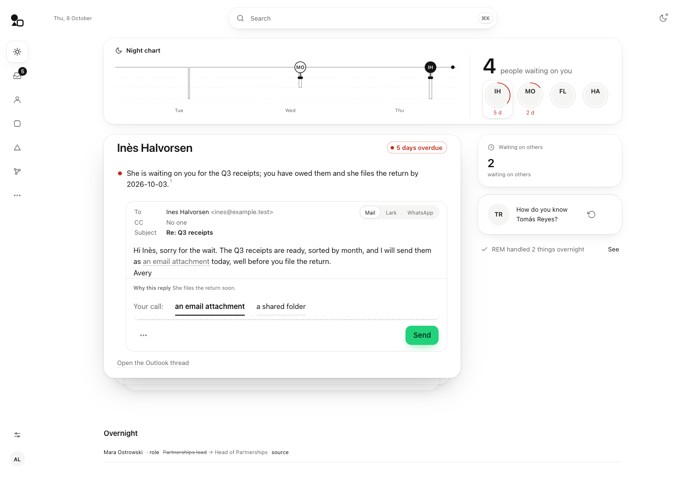
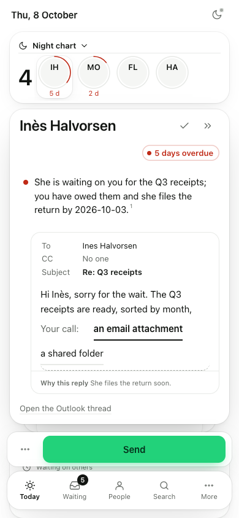
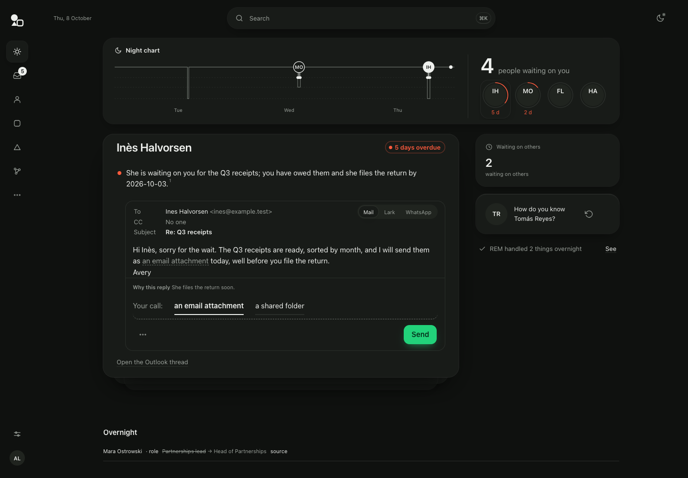
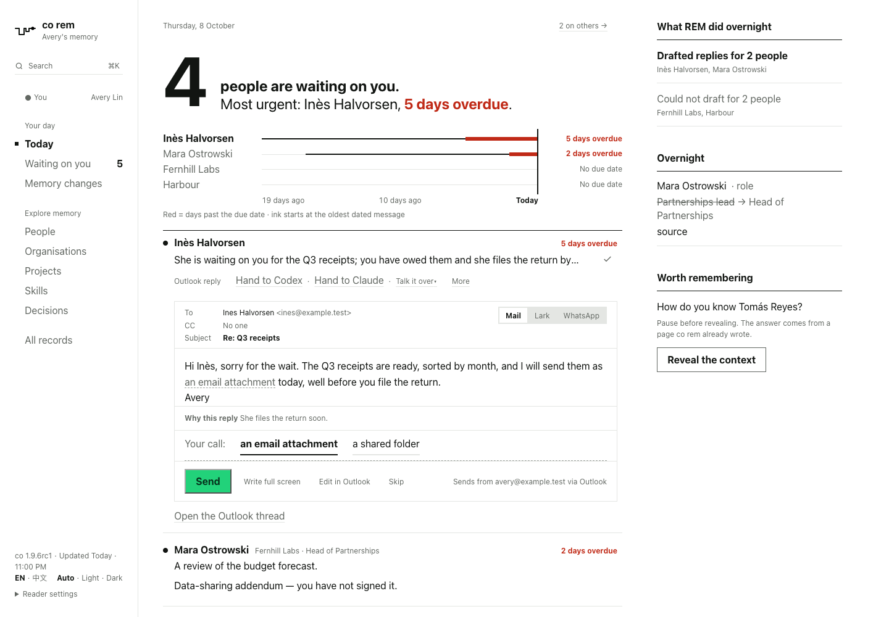
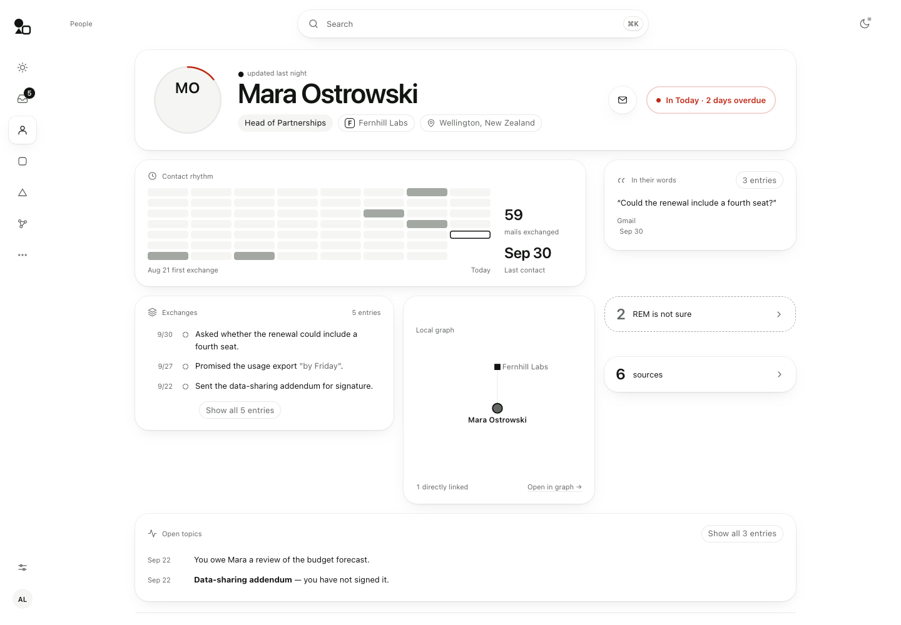
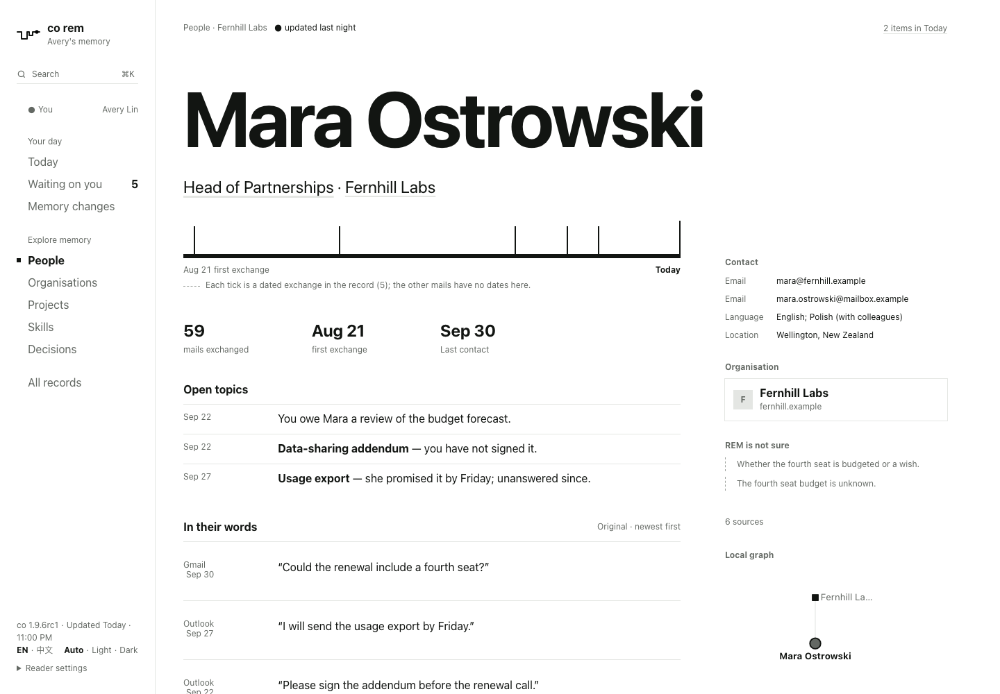

# ConnectOnion 1.9.6rc2 (release candidate)

Stable remains **1.9.5**; Python **3.11+** and the existing dependency floors are retained.

The REM reader starts to look like a desk instead of a document. This is **phase 1 of 3**: the
frame around every page, Today, and a person's record have the new design. Lists and the other
records come in phases 2 and 3; what is not there yet is listed below.

## The frame around every page

- On a desktop the wide sidebar is gone. A narrow rail of icons holds the places you go: Today,
  Waiting (with the one count badge), People, Organisations, Projects, All records. The other
  categories and Memory changes sit behind the three dots; settings and you are at the foot.
- One search pill sits at the top of every page. ⌘K still opens the same search.
- Settings is one sheet: interface language, theme, reduce motion, hide labelled passages, notebook
  languages, the schedule, the release and when the page was rendered, and the shortcuts.
- On a phone a floating tab bar holds Today, Waiting, People, Search and More. More opens every
  other place as a sheet.
- The page is one white canvas (one dark canvas in the dark theme) and cards are lifted by shadow.
  Green means one thing, the action you can take now; red means one thing, overdue.

## Today



- A **night chart** opens the page. It is drawn only from what REM recorded: each run is a dip
  (reading mail and sessions is shallow, rewriting pages is deep), and each reply or task REM
  prepared is a rise with that person's face on it. With one night of records it shows one night.
  On a phone the chart folds under its title.
- Beside it, the number of people waiting on you and their faces. A red ring burns around a face as
  the days overdue add up, with the days under it.
- **One card is raised** at a time: the person, what they are waiting for, and the reply REM
  prepared. Click a face, or press J, K or S, to bring up another card. Words you typed in a
  question or a talk box stay when you change cards.
- **Send is the only green on the page**, and only once it can be sent: while REM's question on the
  card is unanswered, Send is grey and says "Choose above before sending."
- The actions on each row (hand to Codex or Claude, talk, mark done, context, source) appear when
  you hover, focus or tap the row. Write full screen, edit in the mail app and Skip are behind the
  three dots beside Send.
- To the side: how many threads are waiting on others, one "How do you know …?" card, and
  "REM handled N things overnight · See".
- Everything else the old front page showed (overnight changes, a connection to judge, quiet
  threads, this week's pages, the translation notice, processing, maintenance) is in one fold below
  the desk.
- When nothing is open either way, Today says so in one sentence instead of showing an empty box.





Before, in 1.9.6rc1, the same notebook on the same day:



## A person's record



- The top card has their face (with the same overdue ring as Today), name, and chips for role,
  organisation and place. Email, phone and handle are round buttons: hover shows the value, a click
  copies it. One quiet link goes to their card in Today when something is open.
- Below it, a grid: contact rhythm (one cell per day you exchanged mail, the count, the last
  contact), their latest words, the last three exchanges, the people and organisations linked to
  them, what REM is not sure of, sources, sessions that mention them, and open topics. Older quotes,
  all exchanges and all topics open from a chip on their card.
- The record no longer lists every email address as a link up front. The mail button shows up to
  three addresses on hover and copies the first; every address is still in the full note.
- An organisation's last contact now comes from its people, so an organisation whose own page has no
  dated mail no longer looks untouched.

Before, in 1.9.6rc1:



## Not there yet

- **Lists** (Waiting, People, Organisations, Projects, All records, Memory changes) are phase 2.
  They already use the new colours and type sizes but keep their old layouts.
- **The other records** (organisations, projects, skills, decisions and the rest) are phase 3, with
  the same caveat.
- Search takes words as before. Splitting one sentence into a search is not built, so the pill says
  only "Search".
- REM does not offer a guessed answer to its own question on a card; you choose or type it.
- "REM handled N things overnight" can be opened and read. There is no undo for those yet.
- A task's result shows as a card only when the task has a result; there is no preview before that.

## Install after publication

```bash
python -m pip install --upgrade 'connectonion==1.9.6rc2'
```
