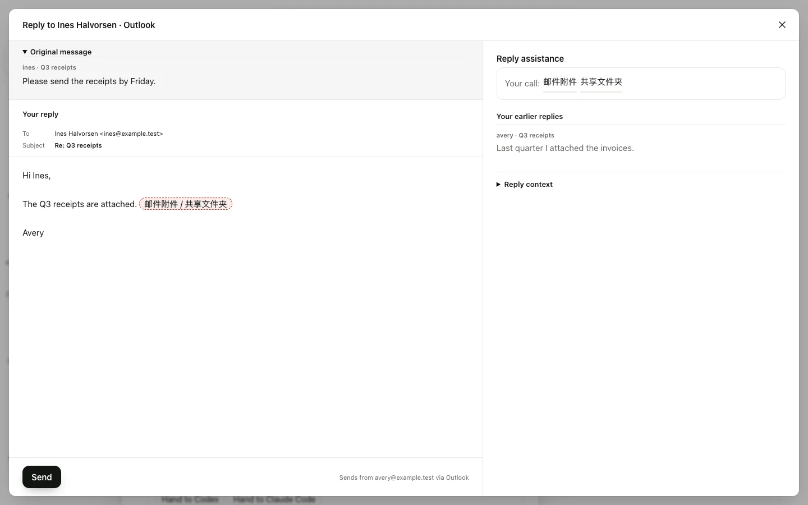

# 1.9.7rc27

Release candidate for 1.9.7. Stable remains 1.9.6.

## Reviewing a reply in REM Today

Open the draft to review what the recipient would read. If a meeting time needs to change, consult the calendar while editing the reply. If you already handled the request elsewhere, mark the Today item done. [Feature PR #3446](https://github.com/openonion/connectonion/pull/3446)

Install this preview with an exact version pin.

```sh
python -m pip install --upgrade 'connectonion==1.9.7rc27'
```



[Today card](assets/v1.9.7rc27/after-today.webp) · [Phone writer](assets/v1.9.7rc27/phone-writer.webp) · [Previous writer](assets/v1.9.7rc27/before-writer.webp)
