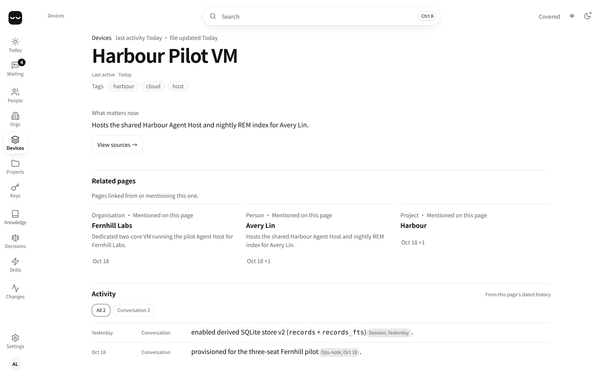

# 1.9.7rc28

Release candidate for 1.9.7. Stable remains 1.9.6.

## REM SQLite store v2, Agent Host boundaries, `devices`, and reader speed (#3458, #3453)

- **Derived SQLite store v2 (`store.py`, `store_build.py`):** `.state/rem.db` adds a universal `records` table with covering B-tree indexes, `rowid`-linked `records_fts` full-text search (with CJK substring fallback and exact tag filtering), and incremental `sync_pages` updates that re-index only modified Markdown files.
- **Single-Host local and remote query doors:** `GET /rem/query` serves loopback browser queries and `WIKI_READ` serves Ed25519-authenticated admin queries over Connect Relay (`records`, `record`, `search`, `people`) without hitting whole-HTML frame limits.
- **Boundary and privacy hardening:** `/rem/*` runs before generic `OPTIONS` preflight (`405`), loopback HTTP enforces `Host` plus same-origin/port `Origin` / `Sec-Fetch-Site` and `HttpOnly; SameSite=Strict` cookies, `session_sync_only` relay peers are rejected, and `privacy="public"` strips `[personal]` / `[sensitive]` sections and private pages in Python before serialization.
- **First-class `devices` category:** `devices/` pages work across `Notebook.stub_device`, `co rem list devices`, SQLite `records`, wikilink/tag resolution, and the REM reader sidebar, list, and detail views.
- **Build and reader de-bottlenecking:** `repair_titles()` runs inside thread-safe `with held(root):` build caching, and `reader.html` memoizes record lookups and language-keyed parsed structures. [PR #3458](https://github.com/openonion/connectonion/pull/3458)



[Devices list](assets/v1.9.7rc28/devices-list-desktop.webp) · [Phone view](assets/v1.9.7rc28/devices-detail-phone.webp)

## Microsoft Teams CLI and `Teams` tool (#3459, #1907)

- **`co teams` and `from connectonion import Teams`:** Reuses the existing `co auth microsoft` sign-in for `co teams check`, `co teams chats` (`ls`), `co teams read`, `co teams send`, `co teams teams`, and `co teams channels`, with 15-minute account-bound row numbers under `~/.co/teams-listings`.
- **Honest Graph account and consent boundaries:** Inspects token `tid` and consumer compact tickets locally before calling Microsoft Graph, refusing personal `outlook.com` MSA tokens with clear guidance while preserving B2B guests; reports the `ChannelMessage.Read.All` tenant-admin boundary on channel reads.
- **Safe sends:** `co teams send` previews the target chat and message body until `--yes`, avoids blind retry prompts on post-submit timeouts, and registers `Teams.send_message` / `co teams send` under tool approval (`external_effect`, `as_owner`). [PR #3459](https://github.com/openonion/connectonion/pull/3459)

Install this preview with an exact version pin.

```sh
python -m pip install --upgrade 'connectonion==1.9.7rc28'
```
