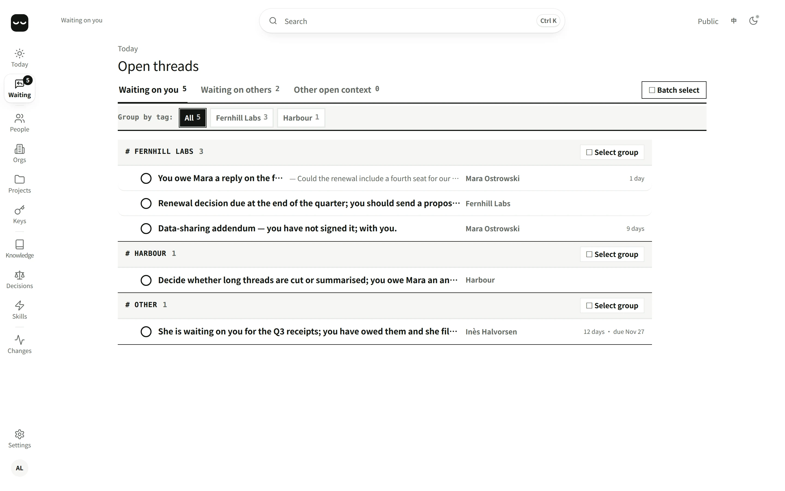

# 1.9.7rc29

Release candidate for 1.9.7. Stable remains 1.9.6.

## Two-screen REM Waiting on You, Today flipper strip, and `owner_record()` self-healing (#3464)

- **Screen 1 — Tag-grouped triage list (`#view=open`):** Opens directly in clean normal mode with direction tabs (`Waiting on you`, `Waiting on others`, `Other open context`), tag filter chips, tag-grouped sections with `Select group`, circular `○` in-place completion (striking through completed rows in place with an undo/hide toast instead of jumping scroll position), task-first titles, and inline quote previews. Multi-select (`Batch select`) stays tucked away until activated and exits on `Escape`.
- **Screen 2 — Focused item console (`#view=open&item=<key>`):** Steps through the exact tag-grouped order (`01 / N`) with `Original message`, merged cross-page context, inline editable reply draft, a single primary action, `Status actions`, `Delegate to agent` (`Hand to Codex`, `Hand to Claude`, `Open original mail`), `Related pages`, auto-advance after action, and `Escape` back to the list.
- **Today (`#`) Focus Deck flipper strip:** Replaces stacked deck shadow borders with a crisp card frame and a synchronized horizontal `.bau-strip` flipper under the active card.
- **Data integrity fixes:** `owner_record(root)` self-heals from `"This is the owner's page."` markers and configured owner email addresses when `.state/map.json` is absent on synced notebooks; `dedupOpenEntries()` merges duplicate cross-page obligations atomically; `rowWords()` strips stray trailing `:.` punctuation. [PR #3464](https://github.com/openonion/connectonion/pull/3464)



[Focused item console](assets/v1.9.7rc29/waiting-detail-desktop.webp) · [Today flipper strip](assets/v1.9.7rc29/today-flipper-desktop.webp) · [Phone view](assets/v1.9.7rc29/waiting-list-phone.webp)

Install this preview with an exact version pin.

```sh
python -m pip install --upgrade 'connectonion==1.9.7rc29'
```
