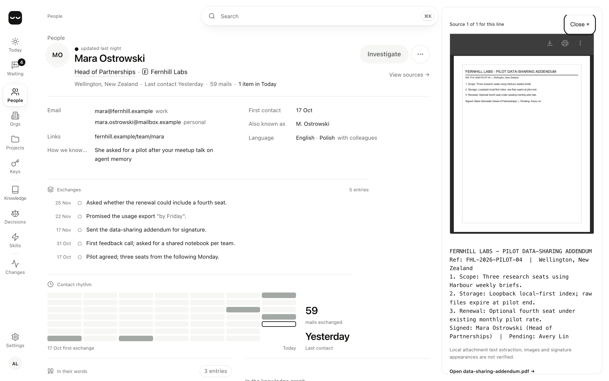

# 1.9.7rc30

Release candidate for 1.9.7. Stable remains 1.9.6.

## REM SQLite store v3, CLI-hosted live reader, and native attachment previews (#3469, #3468, #3467)

- **SQLite store v3 (`rem.db`):** Clean-cut migration to schema version 3 with `auto_vacuum=INCREMENTAL`, persistent `journal_mode=WAL`, per-record incremental upserts, cascading deletes, freelist reclamation, external-content FTS5 (`content='records'`) eliminating duplicate body storage, parameterized CJK and substring search with privacy-ceiling enforcement, and SQLite text caches (`attachments`, `translations_cache`, `research_cache`) keyed by `(size, mtime_ns)`. Completed and abandoned turn scratch under `.state/tasks/` is pruned safely without touching active tasks.
- **CLI-hosted loopback live reader & gzip:** `co rem open` serves the live reader directly over loopback HTTP without rebuilding monolithic offline `file://` snapshots on state changes; lightweight actions (`done`, `ignore`, language switch, translation request) refresh only the live Today shell, idle `/rem/translate-all` status polling stops cleanly in terminal/idle states with TTL-cached counts, and `/rem`, `/rem/data.json`, `/rem/query`, and `/rem/source` negotiate `gzip` compression.
- **Native `/rem/attachment` previews & budget fairness:** Owner-only loopback `/rem/attachment?id=...` serves retained PDFs and images inline (`Content-Security-Policy` with `script-src 'none'`, `X-Content-Type-Options: nosniff`, symlink and traversal rejection) while keeping active formats (`html`, `svg`, `xml`, `js`, Office archives) as safe downloads. Structured excerpts preserve spreadsheet rows and document paragraphs up to 8,000 characters, and bulk mail excerpts no longer starve cited attachments or structured research captures.
- **Reader UI fixes:** Unclipped top hour labels in Today and Agenda schedule grids, and clean mobile `Last night` stretch summaries and avatar strip scrolling without horizontal overflow.



[Today schedule](assets/v1.9.7rc30/today-schedule-desktop.webp) · [Phone view](assets/v1.9.7rc30/today-mobile-phone.webp)

Install this preview with an exact version pin.

```sh
python -m pip install --upgrade 'connectonion==1.9.7rc30'
```
