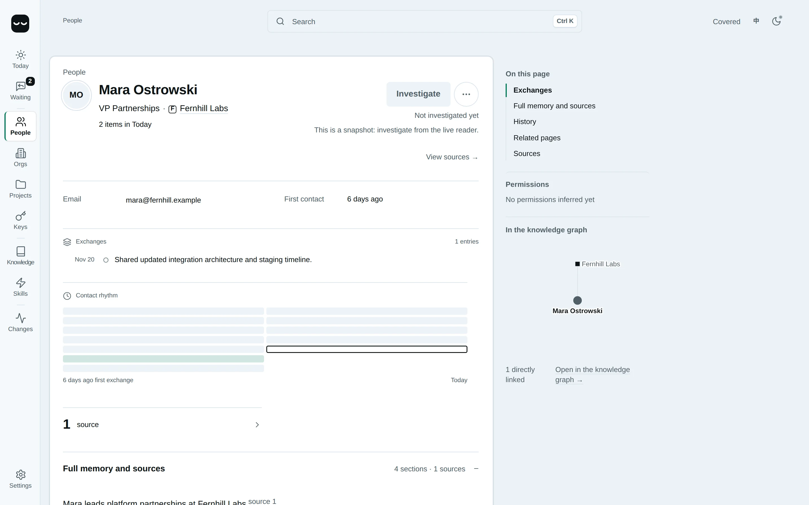

# 1.9.7rc31

Release candidate for 1.9.7. Stable remains 1.9.6.

## REM Porcelain-Viridian skins, three-column reading layout, and 56 real-notebook fixes (#3470)

- **Pluggable skins & three-column reading layout:** Introduces Cold Porcelain grounding (`B >= G >= R`), four selectable skins in Settings and Command Palette (`Porcelain`, `Klein`, `Onion`, `Classic`) across light and dark modes with WCAG AAA canvas-to-ink contrast, and a unified three-column reading frame (`left rail | central sheet | sticky right quick-browse rail`) across entity and entry pages.
- **Interactive triage, privacy redaction & mobile polish:** Fixes `el()` null/boolean attribute serialization (`disabled="null"` freezing batch and item-console actions in `#view=open`), curtains `[sensitive]` and `[personal]` original-message quotes across `.bau-snip` and `.bau-qv` in `cover` and `public` modes while removing empty rows in `public` mode, keeps mobile multi-select checkboxes and 44px touch targets intact on 390px viewports, and fixes Evidence Drawer stacking and responsive width across desktop, tablet, and phone viewports.
- **Large-notebook scale & cross-platform vault hardening:** Paginates large `#c=people` directories (`100` rows initial slice with incremental expansion, keeping initial render under 200ms on 1,300+ contacts), accelerates full-notebook live `#q=` search below 120ms with debounced `history.replaceState` updates, syncs live 2D/3D Knowledge Graph canvases on theme/skin switches, routes `#c=logs` and `#c=notes` to Activity, preserves `#` issue/PR numbers in `plainLine()`, and converts non-macOS Keychain/Chrome vault import errors into clean `409` responses instead of HTTP `500`.



[Klein dark triage](assets/v1.9.7rc31/klein-dark-open-desktop.webp) · [Phone multi-select](assets/v1.9.7rc31/mobile-open-multiselect.webp)

Install this preview with an exact version pin.

```sh
python -m pip install --upgrade 'connectonion==1.9.7rc31'
```
