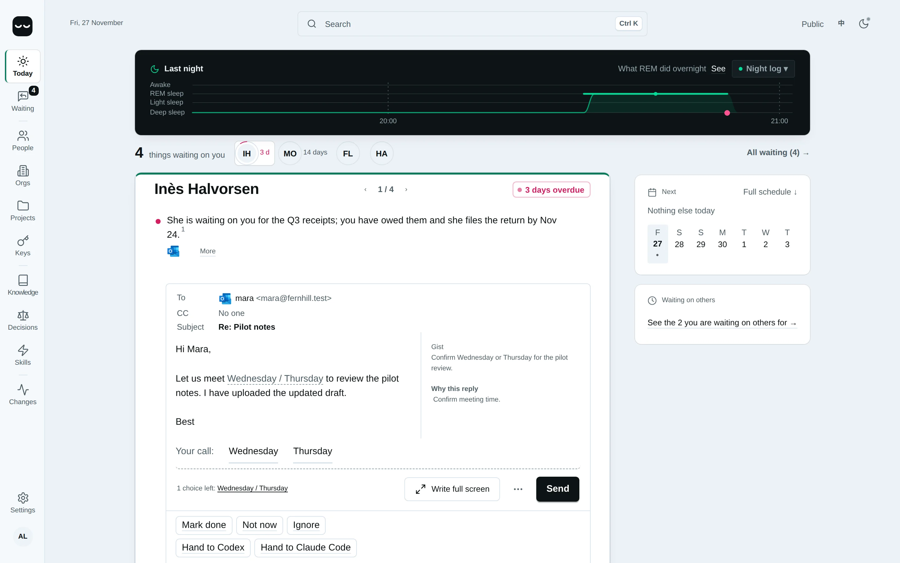

# 1.9.7rc33

Release candidate for 1.9.7. Stable remains 1.9.6.

## Server-side privacy enforcement, visible Today full-screen writer, phone KG labels, data truthfulness, and overnight Aqua reliability

- **Server-side shared snapshot redaction & source isolation (#3435 P0, #3436, #3417, #3387, #3375):** Strips `[personal]` and `[sensitive]` passages, private pages, private cross-links, and translations server-side before serializing shared snapshots (`local=False`), keeps owner local readers intact, hides private task execution summaries and empty private-only section headings at `Public only`, masks private topic titles across links, search results, and knowledge headers below `Show all`, and stops non-default `--root` notebooks from inheriting HOME's `~/.co/wechat/keys.json`.
- **Today full-screen writer & mobile knowledge graph (#3479, #3390 / #3466):** Adds a visible, localized `Write full screen` / `全屏写` button next to Send and More on Today reply cards across all skins and viewports (`>= 44px` touch target on mobile), and adds priority node labels at fitted phone zoom, CJK-aware middle-truncation, tap-to-inspect preview before navigating on touch, and accessible SVG hit-targets on mini-graph links.
- **Data truthfulness & Keys loading polish (#3439, #3438, #3437, #3364):** Demotes elapsed same-day appointments and unfilled placeholder drafts out of Today's #1 lead slot with a recheck banner, aligns Memory changes onto one local-time night window without contradictory empty states, computes organisation overview contact counts from the same live membership model as the list/tree (distinguishing direct vs subordinate members), unifies top-bar/rail translation waiting counts across all views, and displays an accessible loading state while `/rem/keys/env` loads.
- **10-wave `22:00`–`02:30` overnight quota profile & macOS Aqua Host (#3480, #3317, #3452):** Updates opt-in `schedule.profile = overnight` to ten half-hour waves (`22:00`–`02:30`) with `02:45` suppressed, long work gated off after `01:00`, and new model turns halted at `02:40` for a hard `03:00` cutoff; manages macOS REM live Hosts via a reversible `gui/$UID` `ai.openonion.rem-host` LaunchAgent (`Aqua` session) so Keychain/Touch ID prompts survive upgrades and `co rem doctor` reports the Host session; includes Notion numbered lists and `page --md` (#3452).



[Mobile 全屏写](assets/v1.9.7rc33/today-write-full-screen-mobile.webp) · [Phone knowledge graph labels](assets/v1.9.7rc33/phone-kg-labels-mobile.webp)

Install this preview with an exact version pin.

```sh
python -m pip install --upgrade 'connectonion==1.9.7rc33'
```
