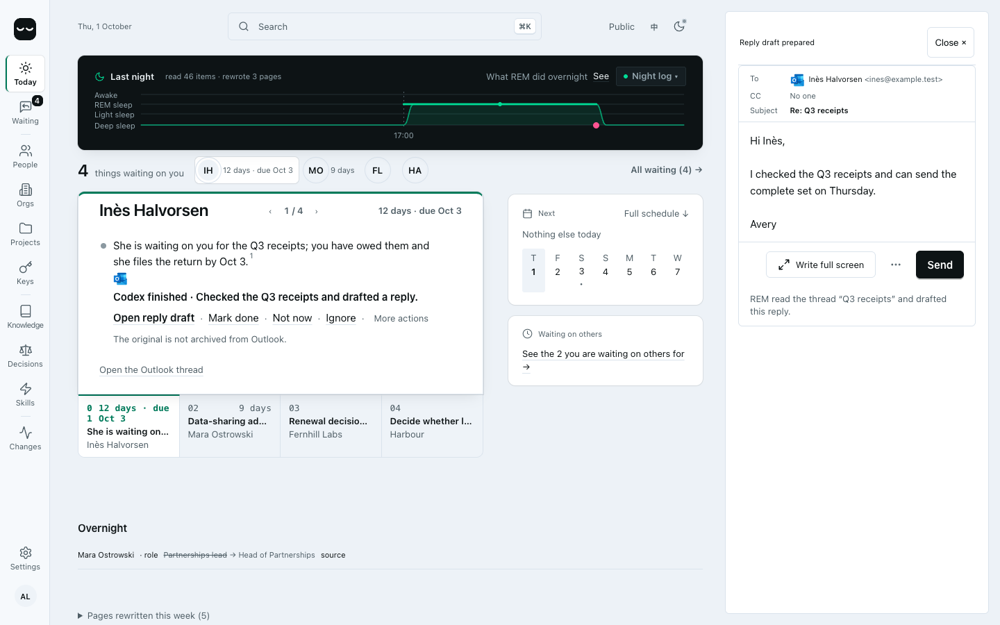

# 1.9.7rc34

Release candidate for 1.9.7. Stable remains 1.9.6.

## REM's nightly upgrade refreshes the open reader

On macOS, updating ConnectOnion could leave an open REM reader showing the
previous build. The new renderer could encounter a derived SQLite index from
an older schema and fall back to the previously cached page. Reopening the
reader did not repair that index.

Opening the default reader on an eligible macOS uv tool installation repairs a
missing nightly upgrade job. That job follows the configured release channel
on PyPI and respects the upgrade opt-out. REM rebuilds an incompatible derived
index under the maintenance lock before publishing the new reader cache. The
owned reader switches on its existing URL after active work and pending
approvals finish. If preparation fails, the saved page stays available and
`co rem upgrade status` reports the failure.
[#3483](https://github.com/openonion/connectonion/issues/3483)

## Open the full-screen writer from a task draft

When a completed Today task prepares a reply, its draft drawer now shows
**Write full screen** beside **More** and **Send** on desktop and phone.
The action opens the reply in the full-screen writer.
[#3484](https://github.com/openonion/connectonion/pull/3484)



[Phone drawer](assets/v1.9.7rc34/task-draft-phone.webp) · [Phone writer](assets/v1.9.7rc34/task-writer-phone.webp) · [Before on desktop](assets/v1.9.7rc34/task-draft-before-desktop.webp) · [Before on phone](assets/v1.9.7rc34/task-draft-before-phone.webp)

Install this preview with an exact version pin.

```sh
python -m pip install --upgrade 'connectonion==1.9.7rc34'
```
